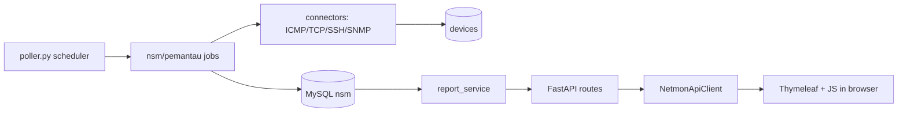
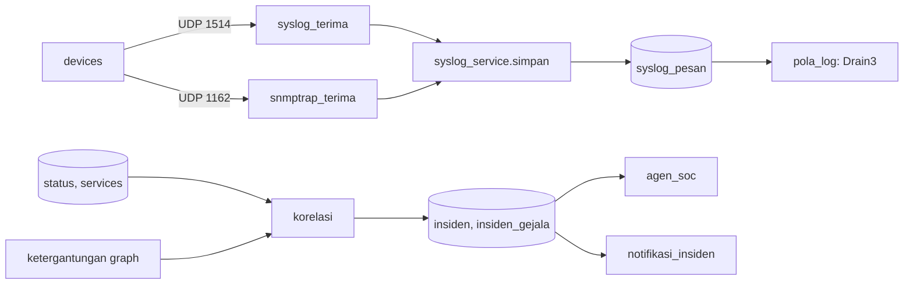
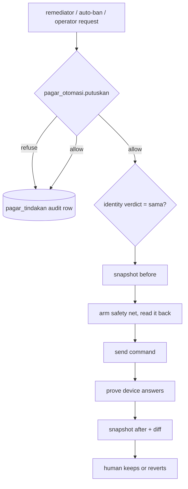

# NSM code architecture

How the code is organised and how data moves through it. All counts and
numbers below describe the lab instance (the nsm-app VM), not a production
system. Module names were checked against the repository; where the code and an
older description disagreed, this page follows the code.

Related: [`design/CLEAN-ARCHITECTURE.md`](design/CLEAN-ARCHITECTURE.md) (the ongoing refactor),
[`design/CLOSED-LOOP-AUTOMATION.md`](design/CLOSED-LOOP-AUTOMATION.md), [`../SECURITY.md`](../SECURITY.md),
[`OPERATIONS.md`](OPERATIONS.md), [`MYSQL.md`](MYSQL.md).

## 1. Core principle

```
Browser --> Java (Spring Boot, "blind viewer") --> Python (FastAPI, "brain") --> MySQL
                                                        ^   ^                    ^
                                           syslog/trap -+   +-- Poller --> Connectors --> devices
```

- **Python is the brain.** All business logic lives there. It is the only part
  that touches the monitoring database and the only part that does SSH, SNMP,
  or any other conversation with a device.
- **Java is a blind viewer.** It renders pages, handles login, roles, and the
  audit log, and forwards JSON from Python unchanged. It has no access to the
  monitoring database, no device access, and no calculations.
  `frontend/.../service/NetmonApiClient.java` is the only HTTP client to the
  backend (`http://localhost:8000`).
- **One narrow exception to "Python never calls Java":** when a device changes
  state, Python hands the notification to Java's localhost-only
  `/internal/notifikasi-device` and `/internal/notifikasi-gabungan` endpoints.
  Java owns the user list and email, so Python never reads user tables.
- **Ownership of data.** Python owns the `nsm` schema (devices, history,
  incidents, configuration snapshots). Java owns a small `nsm_auth` schema
  (users, audit log, blocked IPs, password-reset tokens, notification
  subscriptions) through JPA.

Ports: API 8000 (bound to `127.0.0.1`), frontend 8080. Optional UDP receivers:
syslog 1514 and SNMP trap 1162 (both off by default).

## 2. Processes

| Process | Start command | Role |
|---|---|---|
| API | `uvicorn main:app --host 127.0.0.1 --port 8000` | Serves JSON to the Java frontend; no scheduler |
| Poller | `python poller.py` | APScheduler `BlockingScheduler` running all periodic jobs; also hosts the syslog and SNMP-trap receiver threads |
| Frontend | `./mvnw spring-boot:run` (or the built JAR) | Spring Boot 4.1 / Java 25 / Thymeleaf pages, REST pass-through, WebSocket topology feed |

Because the API and the poller are separate processes writing to the same
database, restart **all three** after a code change (see
[`../CONTRIBUTING.md`](../CONTRIBUTING.md#6-definition-of-done)).

## 3. Backend module map (`backend/`)

| Area | Modules |
|---|---|
| Entry points | `main.py` (exposes `app`, built by `nsm/antarmuka/http/rakit.py`), `poller.py` (job list and intervals only) |
| Clean-architecture layer `nsm/` | `domain/` (frozen dataclasses), `aplikasi/` (contracts as `Protocol`s, use cases in `kasus/`), `infrastruktur/` (`db/gudang.py` repositories, `db/sesi.py` sessions, `jam.py` clock, `warisan/laporan.py` bridge to legacy code), `antarmuka/http/` (route modules in `rute/`, composition root `wiring.py`, app factory `rakit.py`), `pengaturan.py` (immutable settings read once from `config.py`) |
| Periodic jobs `nsm/pemantau/` | `dasar` (ping), `bandwidth`, `layanan`, `trafik`, `firewall`, `konfig`, `sumberdaya`, `syslog`, `wawasan` (LDAP people, rollup, DNS names, notifications, correlation, baseline, log patterns, SOC agent), `_inti` (shared helpers) |
| Reports | `report_service/` package (`ketersediaan`, `dasbor`, `layanan`, `bandwidth`, `trafik`, `firewall`, `konfig`, `insiden`, `topologi`, `identitas`, `ekspor`, `_inti`), `laporan_excel.py`, `laporan_word.py` |
| Device access `connectors/` | `icmp`, `tcp`, `ssh`, `snmp` (v3), `lokal` (the NSM host itself), `layanan`, `konfig`, `konfig_linux`, `kepatuhan`, `firewall`, `aclog`, `ufwlog`, `winfw`, `akseslog`, `sftplog`, `sambaaudit`, `perintahlog`, `flow`, `sumberdaya`, `replikasi`, `ldapdir`, `sadap_http`, `perintah`, `gns3_pemulihan` |
| Device profiles | `perangkat/*.yaml` read by `dialek_perangkat.py`; SQL dialect differences in `dialek.py` |
| Identity | `identitas.py` (verdict logic), `identitas_sumber.py` (reads ARP/SNMP/SSH markers) |
| Time and availability | `jeda.py` (periods NSM was not watching), `rollup.py` (hourly sum and count), `pangkas_data.py` (pruning), `slo.py`, `kapasitas.py`, `prakiraan.py` |
| Events and incidents | `syslog_terima.py` (pure parsing and UDP socket), `syslog_service.py` (database side), `snmptrap_terima.py`, `ketergantungan.py` (dependency graph), `akar.py`, `korelasi.py` (symptoms to incidents), `baseline.py`, `pola_log.py` (Drain3), `anomali.py`, `diagnosa.py`, `kesehatan.py` (NSM's own health) |
| Notifications | `notifikasi.py`, `notifikasi_berjenjang.py`, `notifikasi_insiden.py` (all hand off to Java) |
| Automation (write paths) | `pagar_otomasi.py` (six gates), `pemulih/` (`gns3`, `layanan`, `interface`, `konfig`, `orkestrasi`, `rollback`), `kirim_perintah.py`, `ubah_firewall.py`, `ubah_acl_router.py`, `penjaga_aksi.py` (auto-ban), `injeksi_terjadwal.py` |
| Source of truth | `sot/` (intent catalogue, rendering, service), `drift/` (intent vs observed config) |
| SOC agent | `agen_soc.py` (no code path to devices) |
| Discovery | `penemuan.py` (offers hosts for a human to approve; never adds them) |
| Multi-tenancy | `tenancy.py`, `migrate_tenant.py` |
| Database | `models.py` (45 tables), `database.py` (engines), `penyangga.py` (local buffer), `pindah_data.py`, `init_db.py`, `migrate_*.py` |
| Backup | `backup_nsm.py`, `backup_incremental.py`, `sandi_backup.py` (AES-256-GCM), `backup_status.py`, `lapor_backup.py`, `verifikasi_pulih.py`, `periksa_dump.py` |
| Lab-only / operational | `kirim_ke_nsmapp.py`, `cek_sinkron_nsmapp.py`, `terowongan_gns3.py`, `atur_gns3_nsmapp.py`, `injeksi_*.py`, `pasang_logging_perangkat.py`, `set_*.py`, `add_*.py` (run from the lab host, not shipped to the app VM) |
| Tests | `uji_*.py` (legacy, 105 files), `tests/` (native pytest), `jalankan_ci.py`, `ci_klasifikasi.py`, `ci_manifest.json` |

Frontend (`frontend/src/main/java/id/bsp/frontend/`; package name is a lab label):
`controller/` (page and API pass-through controllers), `service/`
(`NetmonApiClient`, `AuditService`, `EmailService`, `KonteksTenant`),
`security/` (`SecurityConfig`, LDAP login with a break-glass path used only when
the directory is unreachable, `IpBlockFilter`, `LoginAttemptListener`,
`TenantFilter`), `ws/` (`TopologiBroadcaster` polls `/topologi` every 2 s and
broadcasts to browsers only when the content hash changes), `entity/` and
`repository/` (JPA, `nsm_auth` only), `resources/templates/` (Thymeleaf pages).

## 4. Data flows

### 4.1 Monitoring: poller to report



The poller writes `status_logs` (every probe) and `device_events` (only on
UP/DOWN transitions). Reports read events rather than millions of raw rows.

Scheduled jobs (intervals are defaults from `config.py`; each is overridable in
`.env`; every job runs with `max_instances=1`):

| Job | Default interval | Purpose |
|---|---|---|
| ping (`poll_all`) | `POLL_INTERVAL`, 30 s (example `.env` uses 10 s) | ICMP, then TCP probes (22/80/443) if ICMP fails |
| bandwidth | 30 s | Interface counters via SSH or SNMPv3 |
| services | 30 s | TCP/HTTP/MySQL checks on top of devices |
| traffic | 60 s | Access logs, SFTP/SMB audit, connection flows |
| resources | 300 s | Disk, memory, load |
| firewall (+ local Windows firewall) | 300 s | ufw rules, ACL, Windows firewall |
| ACL denies | 300 s | Router `deny ... log` lines |
| ban expiry / auto-ban | 60 s | Expire temporary bans; auto-ban (kill-switch) |
| correlation / incident notifications | `KORELASI_INTERVAL`, 60 s | Symptoms to incidents; one email per incident (opt-in) |
| baseline / log patterns | 300 s | Per hour-of-week behaviour; Drain3 mining |
| SOC agent | 120 s | Triage and proposals (off by default) |
| remediators (`poll_healer`) | `PEMULIH_INTERVAL`, 120 s | Four remediators, all off by default |
| LDAP people | 1800 s | Names and titles, anonymous bind |
| DNS names | 180 s | Reverse lookups (follows the traffic switch) |
| configuration snapshots | 900 s | Snapshot on change, compliance check |
| rollup | 600 s | Hourly summary of `status_logs` |
| identity | 1800 s | Device identity verdicts |
| notifications / tiered | 30 s / `NOTIF_PUTARAN_MENIT` x 60 s | Queue to Java |

Design points worth knowing:

- **Parallel read, serial write.** Pings run concurrently (`ThreadPoolExecutor`);
  database writes stay serial. Measured in the lab: 46 addresses took 53.99 s
  sequentially and 1.01 s concurrently.
- **Anti-flapping.** `DOWN_THRESHOLD` (default 5) consecutive failures before a
  device is DOWN; one success is enough for UP. `StatusLog.sumber`
  (`icmp`/`tcp`/`lokal`) records how reachability was proven, so "ping blocked"
  is never confused with "dead".
- **Hourly rollups store sum and count**, not averages, because an average of
  averages is wrong when sample counts differ. `pangkas_data.py` prunes raw
  rows (35 days) and refuses to if the rollup has not caught up.
- **`jeda.py`** removes time NSM was not watching (poller stopped, device
  paused) from the availability denominator.
- Every job is always registered and returns immediately if its switch is off,
  so changing `.env` takes effect without a scheduler restart.

### 4.2 Events: syslog, traps, correlation



Both receivers run as threads inside the poller process and share one save
function. Parsing is pure (`syslog_terima.urai`, `sidik_templat`) so it is
testable without a network. A *template fingerprint* normalises numbers, IPs,
and interface names, so the same event on different devices hashes the same; a
never-seen template is the most valuable signal. Sender address to device is a
guess and is treated as one; unknown senders are kept.

**Syslog and traps never trigger actions.** They are unauthenticated UDP, so
they are evidence and a reason to run a check, nothing more.

### 4.3 Writes to devices



Write modules: `kirim_perintah.py` (router configuration, command catalogue is
an allowlist), `ubah_firewall.py` and `ubah_acl_router.py` (blocks, always with
a time limit), `penjaga_aksi.py` (auto-ban), and `pemulih/*`. All default to
`sungguhan=False` (dry run). For GNS3/Dynamips nodes `reload in N` is never
used (it halts the emulated machine permanently); recovery goes through the
GNS3 controller API (`connectors/gns3_pemulihan.py`). Gate details are in
[`../CONTRIBUTING.md`](../CONTRIBUTING.md#4-the-six-gate-safety-philosophy-any-automation-change)
and [`design/CLOSED-LOOP-AUTOMATION.md`](design/CLOSED-LOOP-AUTOMATION.md).

### 4.4 Request path for a page

`Browser -> SecurityConfig (login/role) -> TenantFilter -> Controller ->
NetmonApiClient (adds X-NSM-Tenant) -> FastAPI middleware -> route -> use case
or report_service -> ORM (tenant filter) -> database`. The response travels back
as JSON that Java passes to the template or to JavaScript unchanged.

## 5. Storage: MySQL plus a SQLite buffer

- `database.py` builds the engine from `NSM_DB_*`. With `NSM_DB_HOST` empty it
  uses `backend/nsm.db` (SQLite); the path is anchored to the file, not the
  working directory.
- `penyangga.db` is a local SQLite file with the **identical schema**. When
  MySQL is unreachable, the poller keeps recording there; `devices` and
  `services` (and each device's last status) are mirrored into it every good
  round so the poller can still *read* its work list. On recovery the buffer is
  drained into MySQL with the same copy code used for migrations. A monitor
  that stops recording during an outage is useless exactly when needed.
- 45 tables in `models.py`, grouped as: inventory and identity; status and
  rollups; services; traffic and security (flows, file transfers, firewall,
  bans, ACL denies); configuration (snapshots, findings, intent tables, gate
  audit `pagar_tindakan`); syslog, incidents, baselines, log templates, agent
  proposals; backup reports; tenants; discovery offers.
- Strings use named column types so MySQL (which requires `VARCHAR` lengths)
  and SQLite agree; time columns are microsecond precision on MySQL.
- Migrations (`migrate_*.py`) are idempotent and run with poller and API
  stopped. `dialek.py` isolates the few SQL differences between engines.

## 6. Schedulers and receivers, in short

One `BlockingScheduler` in `poller.py`. Optional receivers start before it:
`start_syslog()` (UDP 1514, `SYSLOG_AKTIF`) and `mulai_snmptrap()` (UDP 1162,
`SNMPTRAP_AKTIF`, its own event loop because pysnmp 7 is asyncio). Ports above
1024 are deliberate so the process needs no privileges. The Java side has its
own `@Scheduled` 2-second topology feed. Backups run from the lab host's task
scheduler, not from the poller.

## 7. Security boundaries

| Boundary | What it is |
|---|---|
| API trust | The Python API has no authentication; it relies on binding to `127.0.0.1`. Opening port 8000 turns `X-NSM-Tenant` from an identity into a request. See [`../SECURITY.md`](../SECURITY.md) |
| Tenant isolation | `tenancy.pasang()` installs an ORM-level filter, so callers cannot forget it. Tenant comes from the account database, never from client input, and is cleared in a `finally`. The filter does **not** cover raw `text()` SQL or `mysqldump`; `uji_kebocoran.py` scans for raw SQL on tenant tables |
| Roles | `/admin/**`, config, SoT, drift, gates, tenants, discovery, and all device-changing endpoints require `ADMIN`; `/internal/**` is open at the Spring level and restricted to loopback in the controller |
| Output encoding | Page and log text is inserted with `textContent`, never `innerHTML` |
| Write path | Only the modules in 4.3, always via the gates, always dry-run by default |
| Device identity | Only a verdict of `sama` (same) allows writing, because lab devices often share default addresses |
| Command injection | Device command parameters are validated against an allowlist catalogue (`connectors/perintah.py`, `sot/katalog.py`) |
| Backups | Encrypted (AES-256-GCM, scrypt-derived key) because they leave the machine |
| Known gaps | Device credentials are stored as-is in the database; CSP still allows inline styles; no service-to-service authentication; single poller and API (no high availability) |

## 8. Extension points

| To add | Do this |
|---|---|
| A device platform | Add `backend/perangkat/<name>.yaml` starting at `teruji: dokumentasi`; add recorded output under `perangkat/rekaman/` and a `manifes.yaml` row to reach `rekaman`; only a real device run earns `lab` (and write access). No code change if the schema suffices. See [`../backend/perangkat/README.md`](../backend/perangkat/README.md) |
| A monitor or collector | A connector in `connectors/`, a job in the right `nsm/pemantau/` module, a registration line in `poller.py`, a switch in `config.py` (off by default if invasive), and a table in `models.py` plus an idempotent migration |
| An API route | A module in `nsm/antarmuka/http/rute/`, added to `RUTER` in `rakit.py` (order matters: first match wins, so `/konfig/kepatuhan` precedes `/konfig/{id}`); logic goes in a use case or `report_service`, not in the route |
| A compliance rule or intent key | Add an entry to the catalogue data (`connectors/kepatuhan.py`, `sot/katalog.py`); rules are data |
| A remediator | A module in `pemulih/` that must call `pagar_otomasi.putuskan()` before touching anything, record verification, and ship with a paired restraint/action test |
| A page | Controller plus Thymeleaf template, data via `NetmonApiClient` only; check `SecurityConfig` for the role rule |
| Tests | New tests as native pytest in `backend/tests/`; register converted legacy files in `SUDAH_PINDAH` and keep the manifest fresh |

The refactor toward the `nsm/` layers is incremental: legacy modules such as
`report_service` are reached through `nsm/infrastruktur/warisan/laporan.py`
until functions move into use cases. See
[`design/CLEAN-ARCHITECTURE.md`](design/CLEAN-ARCHITECTURE.md).
