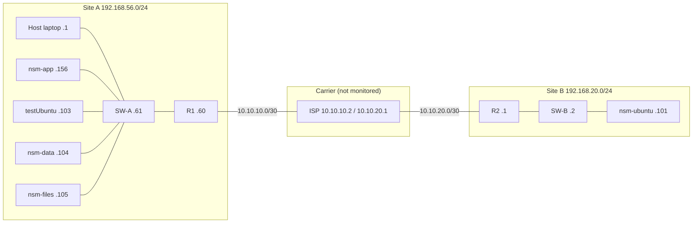

# Two-Site Lab Topology

The lab models a head office and a branch connected through a carrier network. Early on everything sat in one flat `192.168.56.0/24` and the Cisco router was monitored but forwarded nothing. Splitting the lab into two sites made the monitored paths, the firewalling and the failure modes realistic.

> **Lab project.** All devices here are emulated in a personal lab (VirtualBox + GNS3). Nothing connects to any BSP system or network. "BSP" names (LDAP domain, CA) are lab labels only.

Build steps are in [LAB-SETUP.md](LAB-SETUP.md). Start/stop and troubleshooting are in [OPERATIONS.md](OPERATIONS.md).

---

## 1. Diagram

```
 SITE A  192.168.56.0/24                                   SITE B  192.168.20.0/24

 LAN-A -- SW-A -- R1 ===10.10.10.0/30=== ISP ===10.10.20.0/30=== R2 -- SW-B -- LAN-B
  |        .61    .60   Fa1/0 .1   .2 Fa0/0  Fa0/1 .1   .2 Fa0/1  Fa0/0 .1  .2    |
  host .1                                                                  nsm-ubuntu .101
  testUbuntu .103
  nsm-data .104
  nsm-files .105
  nsm-app .156
```



`LAN-A` and `LAN-B` are GNS3 "Cloud" nodes. A Cloud is a plug into a host network adapter, **not** the internet: placing one between two routers merges them into a single L2 segment and they stop routing. The default names `Cloud1`/`Cloud2` made diagrams read backwards, hence the rename.

---

## 2. IP plan

| Network | Purpose |
|---|---|
| `192.168.56.0/24` | Site A LAN (VirtualBox host-only #1) |
| `192.168.20.0/24` | Site B LAN (reached through host-only #2 wire) |
| `10.10.10.0/30` | WAN segment R1 - ISP |
| `10.10.20.0/30` | WAN segment ISP - R2 |

| Device | Address | Role | Monitored by NSM |
|---|---|---|---|
| Host | `192.168.56.1` | VirtualBox/GNS3 host | yes (local/SSH) |
| R1 (emulated Cisco router, Dynamips; IOS 15.x) | `192.168.56.60` (Fa0/0), `10.10.10.1` (Fa1/0) | Site A router | yes |
| SW-A (emulated L2 switch) | `192.168.56.61` (Vlan1) | Site A access switch | yes |
| ISP (emulated Cisco router, Dynamips) | `10.10.10.2` (Fa0/0), `10.10.20.1` (Fa0/1) | Carrier | **deliberately not** |
| R2 (emulated Cisco router, Dynamips; IOS 12.4) | `192.168.20.1` (Fa0/0), `10.10.20.2` (Fa0/1) | Site B router and firewall point | yes |
| SW-B (emulated L2 switch) | `192.168.20.2` (Vlan1) | Site B access switch | yes |
| GNS3 VM | `192.168.56.102` | Runs the emulated nodes | no |
| `testUbuntu` | `192.168.56.103` | Web tier | yes |
| `nsm-data` | `192.168.56.104` | MySQL primary, time source | yes |
| `nsm-files` | `192.168.56.105` | SMB file server | yes |
| `nsm-ubuntu` | `192.168.20.101` | LDAP directory, MySQL replica | yes |
| `nsm-app` | `192.168.56.156` | NSM | n/a |
| `kali-linux` | `192.168.56.151` | Attack simulation | n/a |

The ISP is not monitored on purpose. Its transit segments are not routed to the host, and in a real network the carrier's gear is not yours to monitor. It exists as a path.

---

## 3. Links

| From | To | Meaning |
|---|---|---|
| LAN-A (`eth0`) | SW-A port 0 | Site A wire (host-only #1) |
| SW-A port 1 | R1 Fa0/0 | Switch to router |
| R1 Fa1/0 | ISP Fa0/0 | WAN leg A |
| ISP Fa0/1 | R2 Fa0/1 | WAN leg B |
| R2 Fa0/0 | SW-B port 0 | Router to switch |
| SW-B port 1 | LAN-B (`eth2` only) | Site B wire (host-only #2) |

LAN-B maps only `eth2`. A Cloud that maps every interface would also show `eth0`, and cabling to it joins Site B directly to Site A, bypassing both routers without any error.

---

## 4. Routing

Static routes only; two routers with one path between them gain nothing from OSPF.

| Device | Routes |
|---|---|
| R1 | `192.168.20.0/24 via 10.10.10.2`, default via `10.10.10.2` |
| R2 | `192.168.56.0/24 via 10.10.20.1`, default via `10.10.20.1` |
| ISP | `192.168.56.0/24 via 10.10.10.1`, `192.168.20.0/24 via 10.10.20.2` |
| Switches | `no ip routing`, `ip default-gateway` = local router |
| Host | `192.168.20.0/24 via 192.168.56.60` (persistent) |

Proof that the path is real (from R1):

```
R1# traceroute 192.168.20.2
  1  10.10.10.2     <- ISP, not our device
  2  10.10.20.2     R2
  3  192.168.20.2   SW-B
```

Hop 1 belongs to someone else. That makes the case for encrypting inter-site traffic visible instead of just claimed; it also lets you simulate a carrier outage by stopping the ISP: Site B disappears while Site A stays healthy.

**Simplification to state in any write-up.** The ISP has static routes to both private LANs. A real carrier does not route private addresses; the branches would build a tunnel (VPN/GRE/MPLS) over the carrier and the carrier would see only tunnel packets. The simplification keeps the three-hop path demonstrable without adding a tunnel layer.

---

## 5. Where things live

| Tier | Site A | Site B |
|---|---|---|
| Web | `testUbuntu` (Apache :80, E-Canteen :8080, SFTP :22) | |
| Data | `nsm-data` MySQL :3306 (`nsm`, `nsm_auth`, `ecanteen`) | `nsm-ubuntu` read-only MySQL replica |
| Directory | | `nsm-ubuntu` LDAP :389 (StartTLS) |
| Files | `nsm-files` SMB | |
| Monitoring | host and `nsm-app` | |

**Placement rule: an application and its database are different machines in the same site. Directory and file services may cross sites.**

Measured in the lab through the emulated WAN (routers forwarding in software):

| Path | RTT | Throughput |
|---|---|---|
| Inside Site A | 2.2 ms | 118 Mbit/s |
| Site A to Site B via R1/ISP/R2 | 152 ms | 0.11 Mbit/s |

A web page queries its database 10-50 times, so 152 ms means 1.5-7.5 s of pure waiting. No query tuning fixes that. LDAP is asked once per login and cached by `sssd`, and file service is occasional, so those tolerate distance. Earlier, E-Canteen queried a database in Site B on every page; the emulation merely made an existing design mistake visible.

The database was therefore moved to Site A. `nsm-data` was cloned from `testUbuntu`, so a clone must get fresh values for what must not be duplicated: `/etc/machine-id` (NSM treats it as device identity), SSH host keys, and hostname. VirtualBox regenerates MACs itself.

**Server addresses must be static.** The VirtualBox host-only DHCP range overlaps the server addresses; a moving lease silently invalidates app configs, ACLs and NSM's device table.

---

## 6. Firewalling

Three layers with different jobs:

| Layer | Where | Protects | Logs denials |
|---|---|---|---|
| `ufw` | each server | that host | yes (read by `connectors/ufwlog.py` from `/var/log/ufw.log`) |
| ACL `DARI-LOKASI-A` | R2 Fa0/1, inbound | all of Site B | yes (`deny ... log`) |
| Windows Firewall | host | access to E-Canteen from a phone | no |

```
 testUbuntu --ufw on nsm-data--> nsm-data --ACL on R2--> nsm-ubuntu
              only host and         3306 only            only 389 allowed
              testUbuntu
```

The ACL is installed by `gns3/acl_lokasi_b.py` through the GNS3 console, not the network, so a mistake cannot lock out the way to fix it. The listing, as the script installs it:

```
permit tcp any any established                       replies to Site B-initiated connections
permit icmp 192.168.56.0/24 -> 192.168.20.0/24       NSM ping monitoring
permit tcp host 192.168.56.1 -> 192.168.20.0/24 eq 22   NSM SSH (.101, R2, SW-B)
permit tcp host 192.168.56.1 -> .101 eq 389          NSM LDAP lookup
permit udp host 192.168.56.1 -> .101 eq 161          SNMP bandwidth samples
permit tcp host 192.168.56.103 -> .101 eq 389        sssd on the web server
permit tcp host 192.168.56.104 -> .101 eq 389        sssd on the data server
permit udp host 192.168.56.104 eq ntp -> 192.168.20.0/24   NTP replies from the lab time source
deny ip any any log
```

Rules of thumb that shaped it:

- Every `permit` must point to one real user; otherwise it does not belong. The list shrank when MySQL moved to Site A (two 3306 permits removed) and grew by one when `nsm-data` needed the directory.
- `deny ... log` found a permit the planning missed: SNMP. It is not a monitored *service*, it is a *way of monitoring*, so it never appeared in the service table. Without `log` the bandwidth graph would have gone empty days later.
- NTP is filtered on the *answer*: the request leaves Site B (not filtered), the reply comes back inbound over UDP, which `established` does not cover.
- The router listing is the source of truth. The ACL was once edited directly on the CLI after the data tier moved; a document copy went stale and a test script flagged a deliberately allowed port as a surprise. Check `show ip access-lists DARI-LOKASI-A`.
- Routers keep logs in RAM (`logging buffered 16384 informational`) and are NTP-synced to UTC; otherwise denials carry a "Mar 1" timestamp that cannot be correlated with other machines.

Verification (from `testUbuntu`): `.101:389` open, `.101:3306` refused, `.101:22` refused, `192.168.20.1:22` refused.

---

## 7. Lessons learned

1. **"Can't ping" rarely means the packet did not arrive.** R1 to Site B failed 100% although the ISP reached everything and CDP proved the cables. The request arrived; the reply was dropped because R2 had no route to the transit segment. Fix with a route toward the ISP, and test from both directions.
2. **GNS3 has two servers.** Controller on the host (`127.0.0.1:3080`), compute inside the GNS3 VM (`192.168.56.102:80`). Readiness is whether the *compute* shows `connected`, read via `GET /v2/computes`. Probing the wrong port gave three false "broken" conclusions.
3. **`started` is not running.** After the GNS3 VM restarted, every node was `started`, the compute was connected, and console ports refused connections. Judge a node by its console port; `gns3/hidupkan_ulang_node.py` stops then starts nodes (switches first, then routers) because `start` on a `started` node does nothing.
4. **A 32-bit switch image on a 64-bit host** reports "No such file or directory" for a file that exists; the missing piece is the 32-bit loader/libraries on the GNS3 VM.
5. **The same command is rejected by a neighbour on a different IOS version** (RSA key generation needs `general-keys` on 12.4).
6. **Netplan `apply` adds addresses and never removes** old ones from leftover files, so a VM can hold addresses from both sites.
7. **`Promiscuous: Allow All`** is required on every VirtualBox NIC GNS3 bridges.
8. **Mixed network managers.** Some VMs use netplan/networkd, others NetworkManager; route changes must use the right one.
9. **A missing route is silent.** Without the Site B route, `testUbuntu` reached `.101` through NAT with the host's source address; LDAP accepted it, MySQL refused (`Host ... is not allowed`), which looked like a MySQL problem.
10. **Stale references.** An old demo page still pointed at the pre-move database address and failed while Apache looked healthy; NSM's content check found it. It was paused (`services.aktif = 0`) with the reason recorded in the service history, not "fixed" by reopening cross-site 3306.
11. **Emergency console access.** If a VM loses networking, do not use the VirtualBox console (no copy/paste); add a NAT forward `VBoxManage controlvm <vm> natpf1 "ssh,tcp,127.0.0.1,2222,,22"`. It fails if `ufw` only allows SSH from the lab subnet, because NAT traffic arrives from `10.0.2.x`.

---

## 8. Daily cost and open points

- Since the directory moved to Site B, **GNS3 is mandatory**: without it E-Canteen cannot reach its logins, NSM LDAP login fails and `sssd` stops recognising people. Start GNS3 first (see [LAB-SETUP.md](LAB-SETUP.md)).
- A MySQL replica in Site B (GTID, TLS verified against the lab CA, `super_read_only`) is in place; see [MYSQL.md](MYSQL.md).
- **No LDAP replica in Site A.** If the inter-site path fails, logins in Site A rely on `sssd` cache. Dependencies now cross in both directions: Site A data is copied to Site B, but Site B identity is not copied to Site A. See [design/LDAP-REPLICA.md](design/LDAP-REPLICA.md).
- Traffic is not encrypted between sites in the emulation (see the simplification in section 4).
